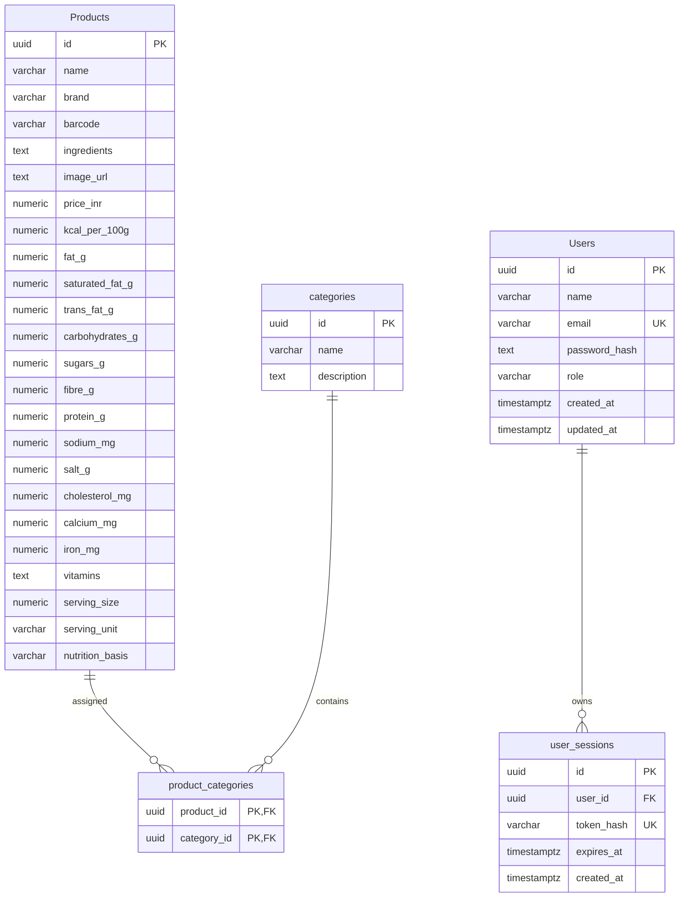

# Database schema and data dictionary

The active database contract is defined by the
[Drizzle schema](../../apps/api/src/db/schema.ts), the single SQL baseline in
[`apps/api/drizzle/`](../../apps/api/drizzle/), API queries, and
the importer at [`script/load_postgres.py`](../../script/load_postgres.py).
The API uses PostgreSQL through `pg`; Drizzle Kit applies the SQL migration
journal.

## Application entity relationships

## Active application tables

The application targets five PostgreSQL tables: `"Products"`, `categories`,
`product_categories`, `"Users"`, and `user_sessions`. Nutrition is stored
directly on each product row; there is no separate nutrition table. Existing
databases may retain additional legacy tables until they are reviewed
separately.

### `"Products"`

One row per product. `barcode` is retained from the existing database schema,
but the current application has no barcode lookup or editing workflow.

| Column                                                                                                                                                                              | Type          | Constraints       | Purpose                                                               |
| ----------------------------------------------------------------------------------------------------------------------------------------------------------------------------------- | ------------- | ----------------- | --------------------------------------------------------------------- |
| `id`                                                                                                                                                                                | `uuid`        | Primary key       | Stable product identifier.                                            |
| `name`                                                                                                                                                                              | `varchar`     | Not null          | Product name.                                                         |
| `brand`                                                                                                                                                                             | `varchar`     | Nullable          | Brand name.                                                           |
| `barcode`                                                                                                                                                                           | `varchar`     | Nullable, unique  | Legacy catalogue value; not currently exposed by the API.             |
| `ingredients`                                                                                                                                                                       | `text`        | Nullable          | Ingredient statement.                                                 |
| `image_url`                                                                                                                                                                         | `text`        | Nullable          | Optional single image URL.                                            |
| `price_inr`                                                                                                                                                                         | `numeric`     | Nullable          | Listed price in Indian rupees.                                        |
| `kcal_per_100g`, `fat_g`, `saturated_fat_g`, `trans_fat_g`, `carbohydrates_g`, `sugars_g`, `fibre_g`, `protein_g`, `sodium_mg`, `salt_g`, `cholesterol_mg`, `calcium_mg`, `iron_mg` | `numeric`     | Nullable          | Nutrition values; retained as supplied, without automatic conversion. |
| `vitamins`                                                                                                                                                                          | `text`        | Nullable          | Source vitamin text.                                                  |
| `serving_size`                                                                                                                                                                      | `numeric`     | Nullable          | Serving quantity.                                                     |
| `serving_unit`                                                                                                                                                                      | `varchar(20)` | Nullable          | Serving unit.                                                         |
| `nutrition_basis`                                                                                                                                                                   | `varchar(20)` | Nullable, checked | `per_serving`, `per_100g`, or `NULL` when unknown.                    |

Product rows have no creation or modification timestamps. Moderators can set
or clear `image_url` through the product form. The API accepts HTTPS image
URLs only, checks that the host resolves publicly, and checks that the URL
responds with an image content type. The CSV importer does not own this field
and leaves it unchanged.

The cleaned CSV has no nutrition-basis field. Applying CSV nutrition updates
requires an explicitly verified `--nutrition-basis`; the importer does not
infer it from column names or serving size.

### `categories` and `product_categories`

`categories` stores unique category names and optional descriptions.
`product_categories` links products to categories with a composite primary
key and cascading foreign keys. Category browsing and search filters use
these tables.

### `"Users"` and `user_sessions`

Authentication timestamps are intentionally retained. `Users.created_at`,
`Users.updated_at`, and `user_sessions.created_at` are not product timestamps.
Sessions reference users with `ON DELETE CASCADE`; the API stores only a
SHA-256 token hash in `user_sessions`.

## Migration and data preservation

`0000_baseline.sql` is the only migration in the repository and is generated
from the current Drizzle schema. On a fresh database it creates the five
target tables and their constraints, foreign keys, and indexes.

For an existing database from the previous migration history, the baseline
creates missing target tables, adds missing product columns, and fills only
empty product image/nutrition fields from the old primary image and matching
`"Nutrition"` row. Numeric values and `nutrition_basis` are copied verbatim;
there is no basis inference or conversion. The old nutrition/image tables,
other legacy tables, and existing product columns remain untouched. Existing
Drizzle migration tracking rows also remain; the new baseline is recorded by
Drizzle after it is applied. Take a backup before applying it to a populated
database.

## CSV mapping

The validator, loader, and synchronization utility use the canonical
`data/processed/packaged_foods_india_cleaned.csv`. The primary loader upserts
product fields, nutrition, categories, and category links. It does not import
images or set product timestamps. The synchronization utility matches existing
records and requires a verified nutrition basis before applying changes; it
does not convert between bases. Logical import backups include `"Products"`
(including image and nutrition values), `categories`, and `product_categories`.
