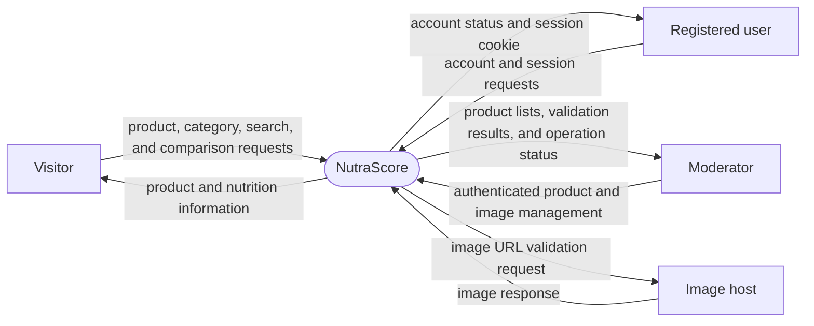

# Data Flow Diagram — Level 0 context

Visitors browse products, categories, nutrition, and comparisons. Registered
users can access account functions. Moderators can manage product details and
images. External image hosts participate when an image URL is validated.
