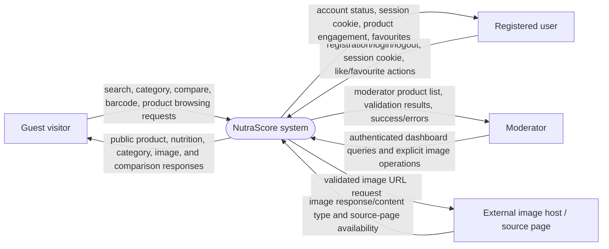

# Data Flow Diagram — Level 0 context

At Level 0, NutraScore is treated as one system. Internal Fastify routes,
PostgreSQL tables, and Svelte components are intentionally not shown as
separate processes.

## Context flows

- Guest access covers public search, autocomplete, categories, product details,
  barcode lookup, comparison, and public nutrition/image responses.
- Registered-user flows add registration, login, logout, authenticated
  session-cookie handling, likes, favourites, and profile access.
- Moderator flows are the same authenticated system plus protected image
  listing, replacement, removal, and review operations.
- External image hosts participate only when moderator image validation or the
  separate image enrichment operation checks an image URL. Search engines are
  not application API dependencies.

## Balance note

The Level 1 processes below decompose the same four classes of system input and
output. PostgreSQL and individual routes appear only after the system boundary
is opened.

## Implementation references

- API registration: [`apps/api/src/index.ts`](../../apps/api/src/index.ts)
- Public product/search routes:
  [`products.ts`](../../apps/api/src/routes/products.ts),
  [`search.ts`](../../apps/api/src/routes/search.ts)
- Auth/session routes:
  [`auth.ts`](../../apps/api/src/routes/auth.ts)
- Moderator image validation:
  [`moderator.ts`](../../apps/api/src/routes/moderator.ts)

