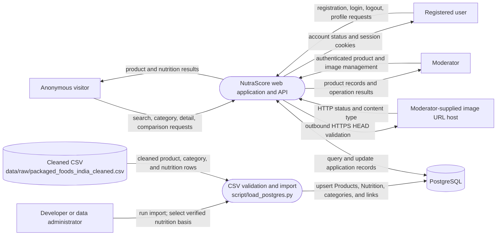

# Data Flow Diagram — Level 0 context

The diagram separates live application traffic from the one-time or
administrator-run CSV import. The importer is a development/administrative
utility, not an application service.

The web application uses the Fastify API to access PostgreSQL. The CSV
importer independently validates and writes the cleaned file; it does not
start the app, apply migrations, or replace the database.

The API validates moderator-supplied image URLs with an HTTPS `HEAD` request.
This is not an automated image discovery or enrichment flow.
