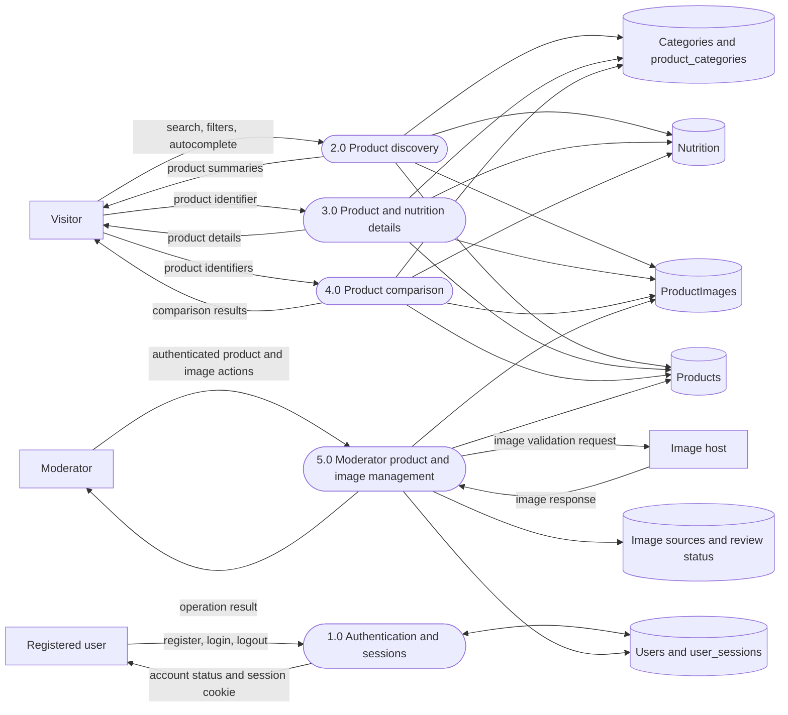

# Data Flow Diagram — Level 1

The API implements the flows through its authentication, search, product,
category, comparison, and moderator route plugins. Product and category data
are read from PostgreSQL; moderator image changes update image and review
records.
