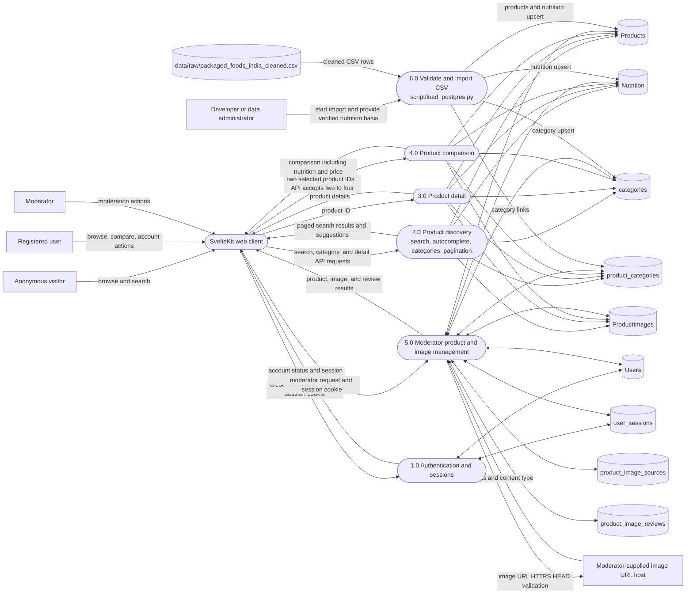

# Data Flow Diagram — Level 1

This diagram shows current user-facing API processes and the separate
development-time CSV import. The data stores are PostgreSQL tables; the
importer reads the raw cleaned CSV path shown below.

The user-facing discovery process reads paged product summaries; autocomplete
is a separate API operation within discovery. Category browsing uses
`categories` and `product_categories`. Product details and comparisons read
the same product, nutrition, category, and image stores.

The importer at `script/load_postgres.py` reads
`data/raw/packaged_foods_india_cleaned.csv`, requires the database schema and
foreign keys to exist, and writes only `Products`, `Nutrition`, `categories`,
and `product_categories`. Its dry run does not connect to PostgreSQL.

The API image management flow stores moderator-supplied image and source
metadata; it does not perform automated image enrichment.
