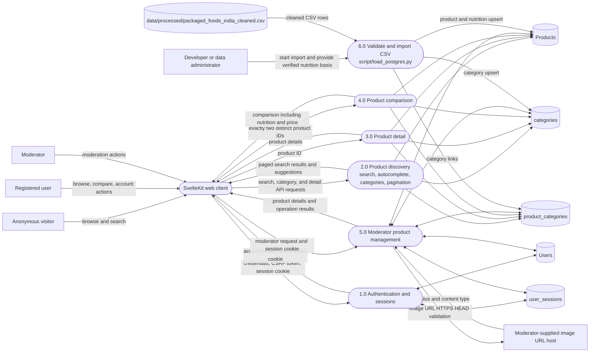

# Data Flow Diagram — Level 1

This diagram shows current user-facing API processes and the separate
development-time CSV import. The data stores are the five active PostgreSQL
tables; nutrition fields are stored on `Products`.

The user-facing discovery process reads paged product summaries; autocomplete
is a separate API operation within discovery. Category browsing uses
`categories` and `product_categories`. Product details and comparisons read
the same product row (including nutrition and image fields) and category links.

Product images are stored as the optional `Products.image_url` value. The
moderator product form sets or clears that value; no separate image or review
stores are used.

The importer at `script/load_postgres.py` reads
`data/processed/packaged_foods_india_cleaned.csv`, requires the database
schema and foreign keys to exist, and writes only `Products`, `categories`,
and `product_categories`. Its dry run does not connect to PostgreSQL.

The API validates moderator-supplied image URLs but does not perform automated
image enrichment.
