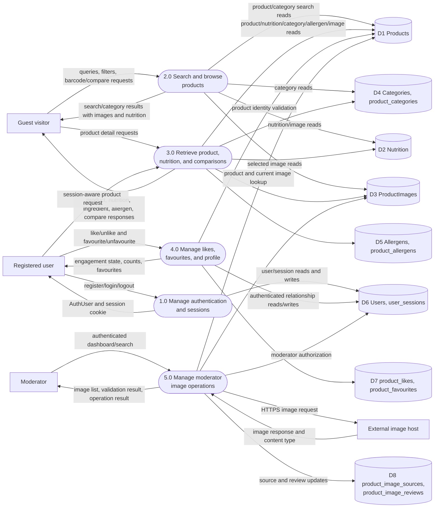

# Data Flow Diagram — Level 1 system decomposition

This decomposition follows the implemented API route plugins and their
PostgreSQL access. Public browsing remains separate from authenticated
engagement and moderator operations.

## Process mapping

| Process | Implemented modules/routes |
|---|---|
| 1.0 Manage authentication and sessions | [`auth.ts`](../../apps/api/src/auth.ts), [`routes/auth.ts`](../../apps/api/src/routes/auth.ts), login/register/profile UI |
| 2.0 Search and browse products | [`routes/search.ts`](../../apps/api/src/routes/search.ts), [`routes/categories.ts`](../../apps/api/src/routes/categories.ts), `discover/+page.svelte`, category UI |
| 3.0 Retrieve product, nutrition, and comparisons | [`routes/products.ts`](../../apps/api/src/routes/products.ts), [`routes/barcode.ts`](../../apps/api/src/routes/barcode.ts), [`routes/compare.ts`](../../apps/api/src/routes/compare.ts), product/compare UI |
| 4.0 Manage likes, favourites, and profile | product engagement endpoints, [`routes/account.ts`](../../apps/api/src/routes/account.ts), favourites/profile UI |
| 5.0 Manage moderator image operations | [`routes/moderator.ts`](../../apps/api/src/routes/moderator.ts), moderator dashboard UI |

## Data stores

- `D1`–`D5` are the imported catalogue and nutrition stores.
- `D6` stores account identities and hashed session references.
- `D7` stores user/product relationships.
- `D8` stores image provenance and moderator review state.

## Scope limitations

Compare and barcode response paths currently do not include the authenticated
like/favourite fields that product detail and search responses include.
Category product responses also expose catalogue/nutrition/image fields without
engagement state. This is reflected in the data flow rather than treated as a
planned feature.

