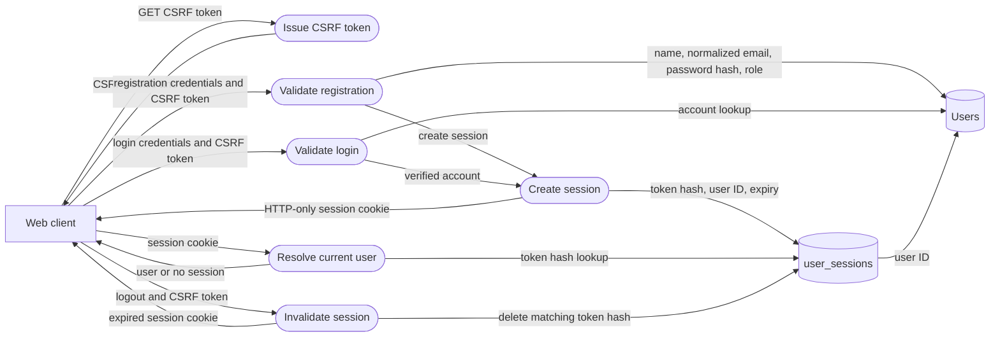
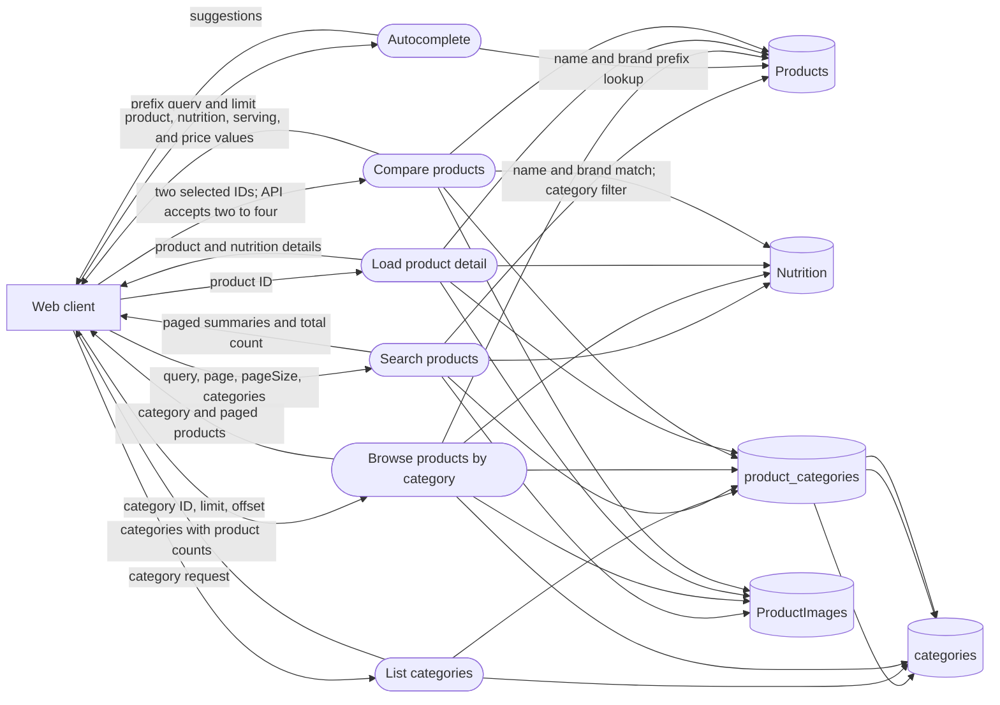
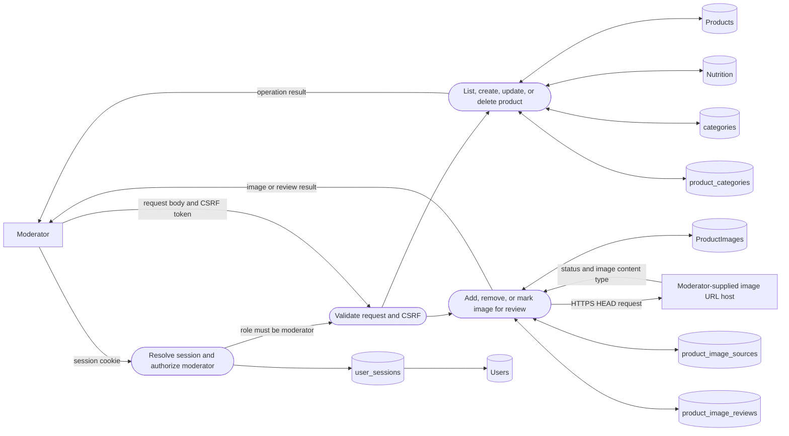
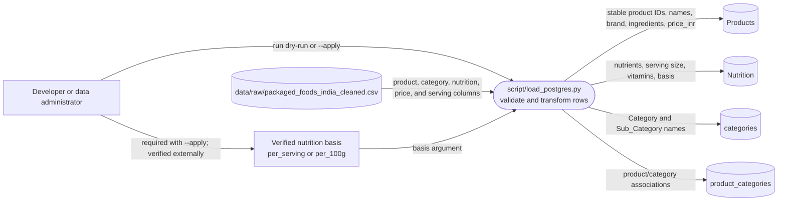

# Data Flow Diagram — Level 2

## Authentication and sessions

The API stores an opaque session token only as a SHA-256 hash in
`user_sessions`; the raw token is sent to the browser as an HTTP-only cookie.
State-changing account and moderator requests require the CSRF cookie value in
the `X-CSRF-Token` header. Moderator authorization additionally checks the
`Users.role` value.

## Product discovery, details, and comparison

Search supports name/brand matching, pagination, and category filters.
Category routes provide category lists and paginated products. Detail and
comparison responses include nullable product price and nutrition values.
The current web comparison store limits selection to two products; the API
accepts between two and four IDs and rejects requests outside that range.

## Moderator product and image management

Moderator endpoints list and create products, retrieve and update product
details, delete products, and manage product images and review status.
Moderator-supplied image URLs are checked for HTTPS and a reachable image
response. No automated image search or image-enrichment task is part of this
application flow.

## Development-time CSV import

The importer is separate from runtime API flows. It uses pandas and DuckDB,
validates the CSV and required PostgreSQL tables/foreign keys, and applies
changes in a transaction only with `--apply`. The CSV has no nutrition-basis
field, so an apply requires an explicit verified `--nutrition-basis`; the
script does not determine the basis from the values or serving size. Missing
CSV values are authoritative for fields represented in the file and may clear
those fields on import.
