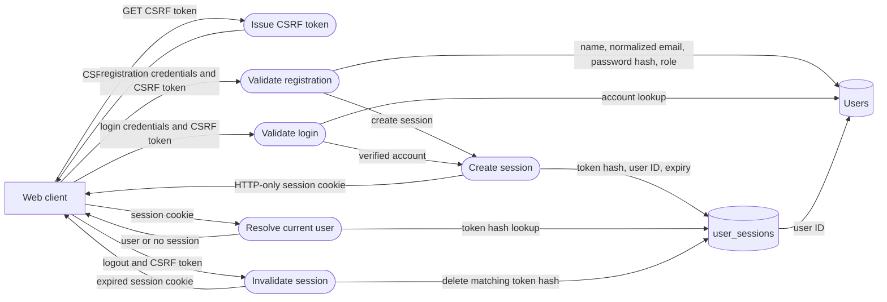
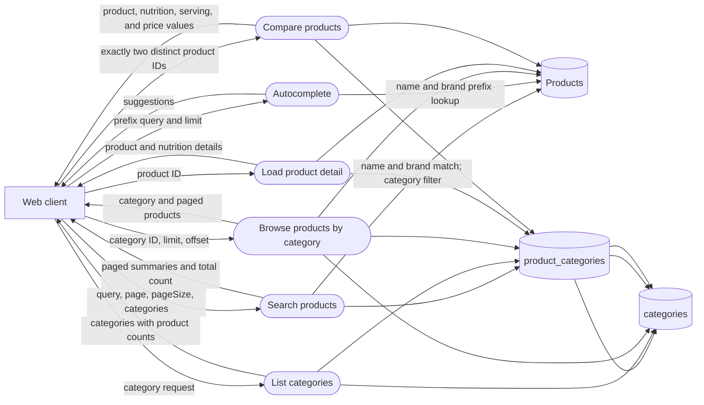
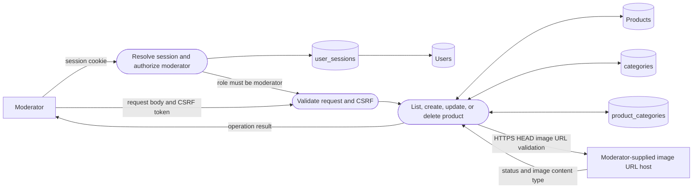
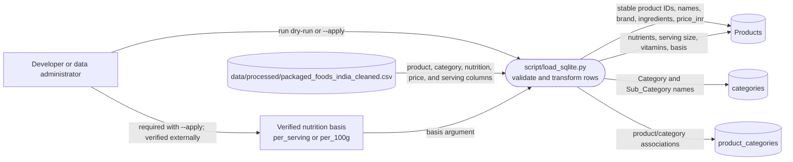

# Data Flow Diagram — Level 2

## Authentication and sessions

The API stores an opaque session token only as a SHA-256 hash in
`user_sessions`; the raw token is sent to the browser as an HTTP-only cookie.
State-changing account and moderator requests require the CSRF cookie value in
the `X-CSRF-Token` header. Moderator authorization additionally checks the
`Users.role` value.

## Product discovery, details, and comparison

Search supports name/brand matching, pagination, and category filters.
Category routes provide category lists and paginated products. Detail and
comparison responses include nullable product price and nutrition values
stored on each `Products` row.
Both the web client and API require exactly two distinct product IDs for a
comparison. Image URLs are returned as part of the product record.

## Moderator product management

Moderator endpoints list, create, retrieve, update, and delete products.
Create/edit requests can set or clear one optional image URL, which is checked
for HTTPS and a reachable image response.

## Development-time CSV import

The importer is separate from runtime API flows. It uses Python's CSV and
SQLite libraries, validates the source, and adds missing records in a
transaction only with `--apply`. The CSV has no nutrition-basis field, so an
apply requires an explicitly verified `--nutrition-basis`. Existing product
values are not overwritten.
