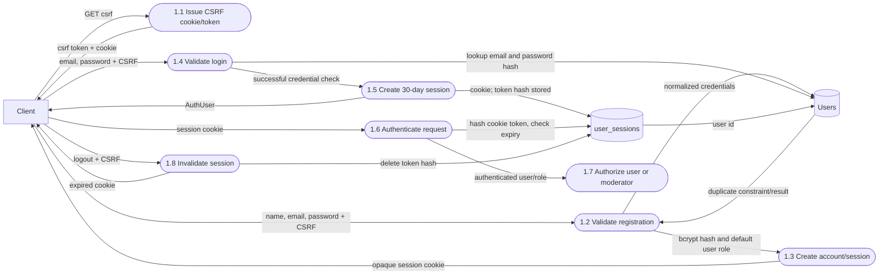
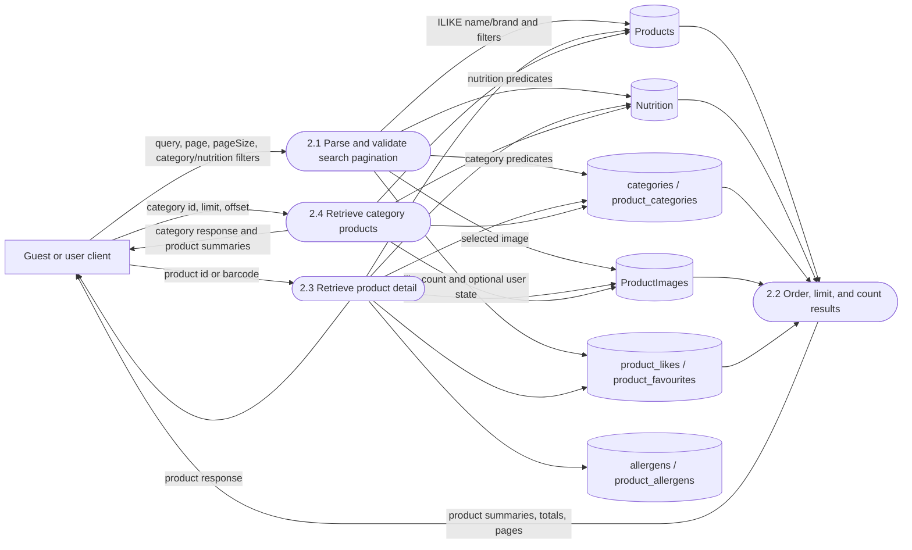
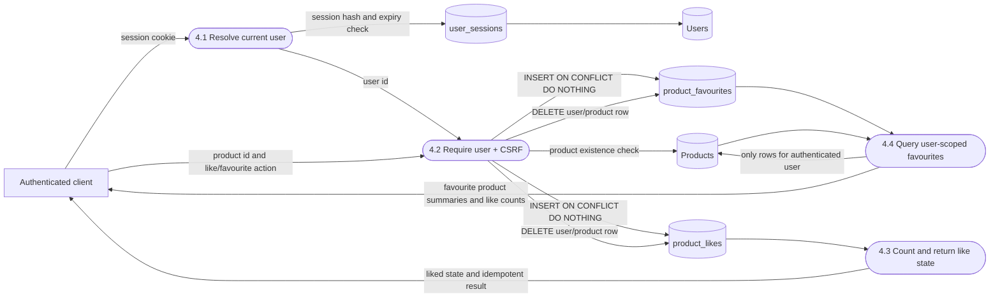
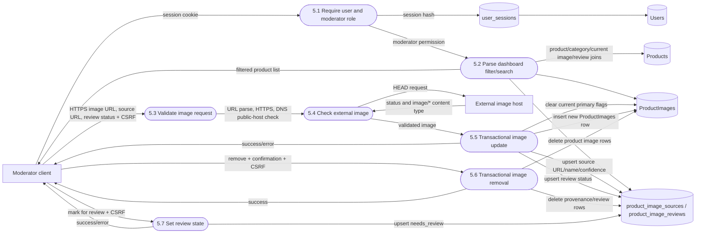

# Data Flow Diagram — Level 2 detailed flows

The following diagrams expand the Level 1 processes that contain the most
security- and data-sensitive behavior. Each subprocess is an implemented route
or helper; no unimplemented workflow is shown.

## 1.0 Authentication and session management

Details:

- `name` is trimmed and must be 2–120 characters.
- Email is lowercased and checked by the API email pattern.
- Password length is 8–128 characters and is bcrypt-hashed.
- Registration never accepts a role; the database default is `user`.
- Failed login attempts are counted in an in-memory email/IP window: ten
  attempts per fifteen minutes.
- The browser uses `credentials: include`; state-changing calls send the
  non-HTTP-only CSRF cookie value in `X-CSRF-Token`.

## 2.0 Product discovery and nutrition retrieval

Implemented public endpoints include `/api/products/search`,
`/api/products/autocomplete`, `/api/products/:id`,
`/api/products/barcode/:barcode`, `/api/categories`, and
`/api/categories/:id/products`.

## 4.0 Likes and favourites

The composite `(user_id, product_id)` primary keys prevent duplicate
relationships. The favourites query is constrained by the authenticated
session’s user id; it does not accept a user id from the client.

## 5.0 Moderator image management

The moderator route is [`routes/moderator.ts`](../../apps/api/src/routes/moderator.ts).
It does not determine whether the remote image depicts the correct product; the
stored moderator-supplied provenance explicitly says identity requires human
review by default. The URL validator checks reachability and content type, not
semantic product identity.

## Features outside these Level 2 flows

- Compare is a public read-only request for two to four product IDs.
- Barcode lookup is a public read-only exact `Products.barcode` lookup.
- Barcode scanning is a browser component that supplies a barcode to the API;
  camera decoding is not a PostgreSQL process.
- The separate image enrichment runner can write image/provenance records, but
  it is not invoked by the Fastify API and is intentionally not represented as
  a user-request subprocess.

## Implementation references

- Authentication helpers: [`apps/api/src/auth.ts`](../../apps/api/src/auth.ts)
- Authentication routes: [`apps/api/src/routes/auth.ts`](../../apps/api/src/routes/auth.ts)
- Search: [`apps/api/src/routes/search.ts`](../../apps/api/src/routes/search.ts)
- Product detail/engagement: [`apps/api/src/routes/products.ts`](../../apps/api/src/routes/products.ts)
- Favourites: [`apps/api/src/routes/account.ts`](../../apps/api/src/routes/account.ts)
- Moderator operations: [`apps/api/src/routes/moderator.ts`](../../apps/api/src/routes/moderator.ts)
- PostgreSQL schema: [`apps/api/src/db/schema.ts`](../../apps/api/src/db/schema.ts)

