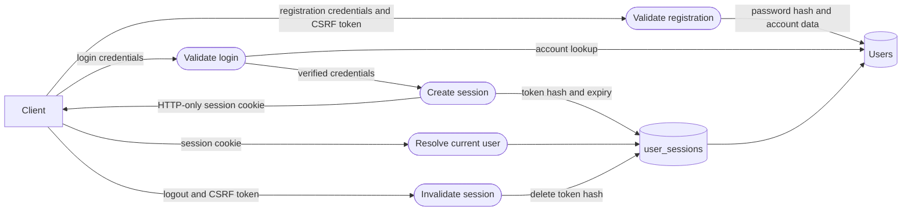
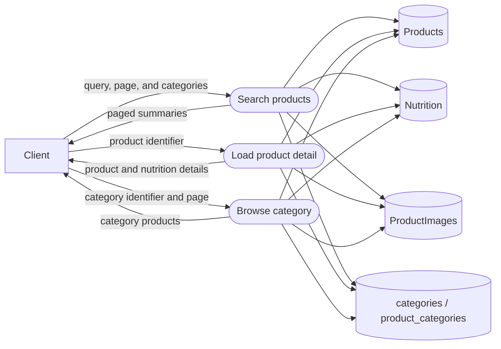
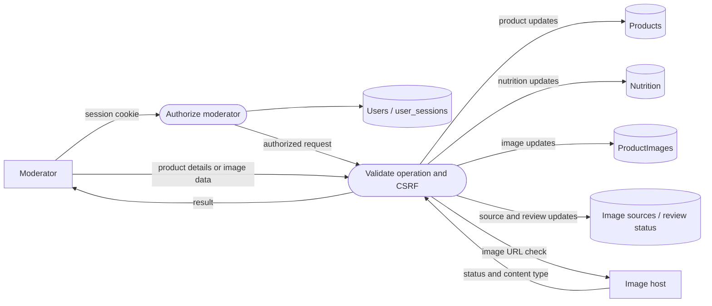

# Data Flow Diagram — Level 2

## Authentication and sessions

Registration normalizes account details and hashes passwords. Session tokens
are opaque, and only their hashes are stored in PostgreSQL. State-changing
requests require CSRF validation.

## Product discovery and detail

Search matches product names and brands and supports pagination and category
filters. Product detail includes ingredients, categories, price, product
labels, images, serving information, and nutrients.

## Moderator product and image operations

Image URL validation checks HTTPS, public-host resolution, response status,
and image content type. Moderator review determines whether an image is
appropriate for its product.
