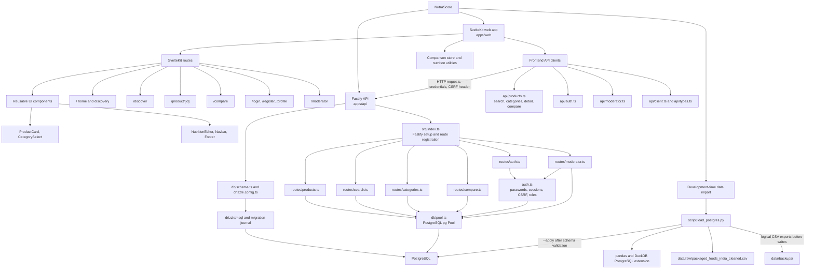

# NutraScore structure chart

The chart shows the main runtime modules and the separate CSV import utility.
It does not imply that API handlers use Drizzle queries: current route
implementations issue SQL through the PostgreSQL `pg` pool.

The UI route files are under `apps/web/src/routes/`; shared UI components,
API wrappers, types, and the comparison store are under `apps/web/src/lib/`.
The API registers its route plugins in `apps/api/src/index.ts`. Runtime route
handlers and authentication helpers share the PostgreSQL pool. Drizzle Kit
uses `db/schema.ts` for schema tooling and the SQL migrations in `drizzle/`.

`script/load_postgres.py` is an independent administrative/development tool.
It reads the cleaned CSV from `data/raw/`, validates required columns and
database relationships, and uses pandas and DuckDB to optionally apply
products, nutrition, categories, and category links to PostgreSQL. It does
not run migrations or use the processed-directory copy as its input.
