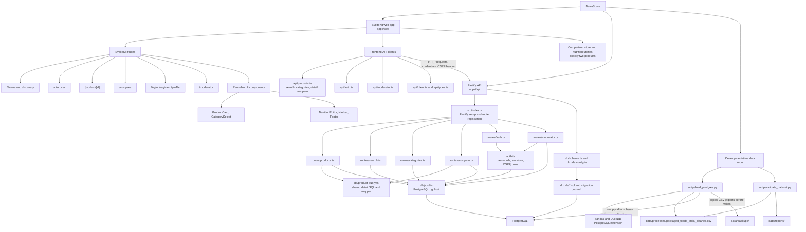

# NutraScore structure chart

The chart shows the main runtime modules and the separate CSV import utility.
It does not imply that API handlers use Drizzle queries: current route
implementations issue SQL through the PostgreSQL `pg` pool.

The UI route files are under `apps/web/src/routes/`; shared UI components,
API wrappers, types, and the comparison store are under `apps/web/src/lib/`.
The API registers its route plugins in `apps/api/src/index.ts`. Runtime route
handlers and authentication helpers share the PostgreSQL pool. Drizzle Kit
uses `db/schema.ts` for schema tooling and the SQL migrations in `drizzle/`.

Product detail and comparison routes share their select and response mapper
through `db/product-query.ts`, while executing SQL through the PostgreSQL pool.
`script/validate_dataset.py` runs read-only quality checks and writes review
reports only when it finds candidates. `script/load_postgres.py` validates
required columns and database relationships, then uses pandas and DuckDB to
optionally apply product fields (including nutrition), categories, and
category links to PostgreSQL. Both are administrative/development tools that
read the canonical cleaned CSV; neither runs migrations.
