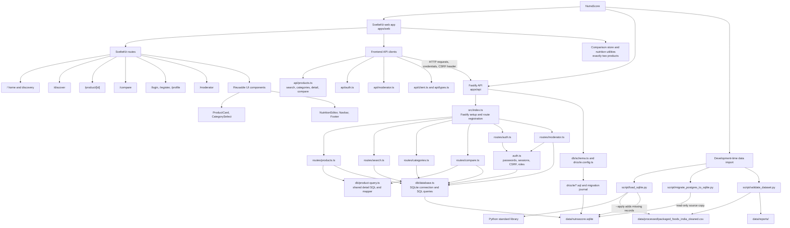

# NutraScore structure chart

The chart shows the main runtime modules and separate data tools. Route SQL
runs through the SQLite-backed database module; Drizzle Kit manages schema
migrations.

The UI route files are under `apps/web/src/routes/`; shared UI components,
API wrappers, types, and the comparison store are under `apps/web/src/lib/`.
The API registers its route plugins in `apps/api/src/index.ts`. Runtime route
handlers and authentication helpers share the SQLite connection.
Drizzle Kit uses `db/schema.ts` and migrations in `drizzle-sqlite/`.

Product detail and comparison routes share their select and response mapper
through `db/product-query.ts`, while executing SQL through the SQLite database
module.
`script/validate_dataset.py` runs read-only quality checks and writes review
reports only when it finds candidates. `script/load_sqlite.py` validates the
canonical cleaned CSV and adds missing product and category data.
`script/migrate_postgres_to_sqlite.py` is an optional read-only-source
transfer utility for existing application data.
