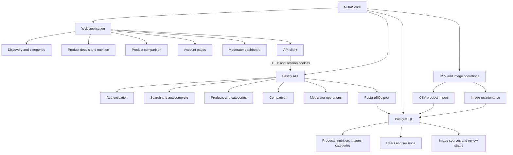

# NutraScore structure chart

The web application is in `apps/web/`. API route plugins, authentication,
database access, and migrations are in `apps/api/`. The root `script/` folder
contains CSV preparation/import and image maintenance tools.
