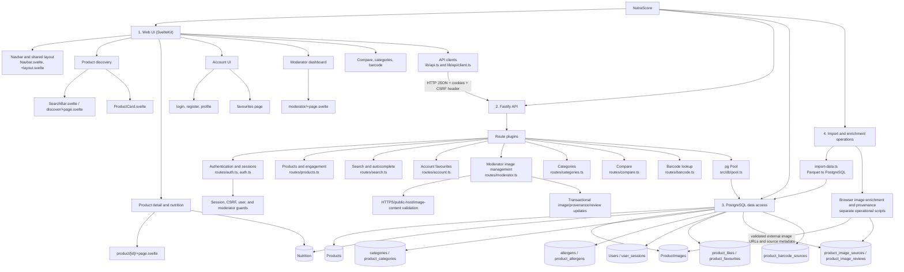

# NutraScore structure chart

The structure chart groups the implemented modules by responsibility rather than
listing every source file as a separate top-level component.

## Module responsibilities

### Web UI

- [`+layout.svelte`](../../apps/web/src/routes/+layout.svelte) composes
  [`Navbar.svelte`](../../apps/web/src/lib/components/Navbar.svelte), page content,
  and the footer.
- Discovery uses [`discover/+page.svelte`](../../apps/web/src/routes/discover/+page.svelte)
  and [`ProductCard.svelte`](../../apps/web/src/lib/components/ProductCard.svelte).
- Product details and nutrition are rendered by
  [`product/[id]/+page.svelte`](../../apps/web/src/routes/product/[id]/+page.svelte).
- Authentication/account pages are under `apps/web/src/routes/login`,
  `register`, `profile`, and `favourites`.
- Moderator image management is under
  [`moderator/+page.svelte`](../../apps/web/src/routes/moderator/+page.svelte).

### API

[`index.ts`](../../apps/api/src/index.ts) registers route plugins under `/api`,
configures credentialed CORS using `WEB_ORIGIN`, and exposes `/api/health`.
Routes use the shared [`pool.ts`](../../apps/api/src/db/pool.ts) PostgreSQL pool.

### Operational code

[`import-data.ts`](../../apps/api/src/db/import-data.ts) imports Parquet data
using DuckDB and Drizzle. Image enrichment is not a Fastify request handler;
it is an external/background operational path that writes `ProductImages` and
provenance records.

## Important implementation boundary

The current SvelteKit frontend is primarily client-rendered and calls the
Fastify API directly. The API, not the frontend, performs authentication,
authorization, SQL filtering, image URL validation, and database writes.

